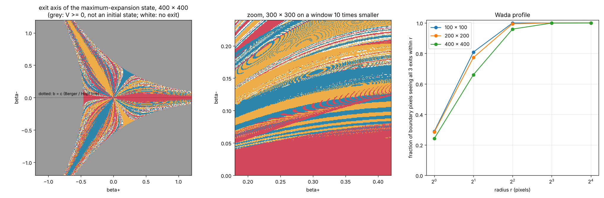
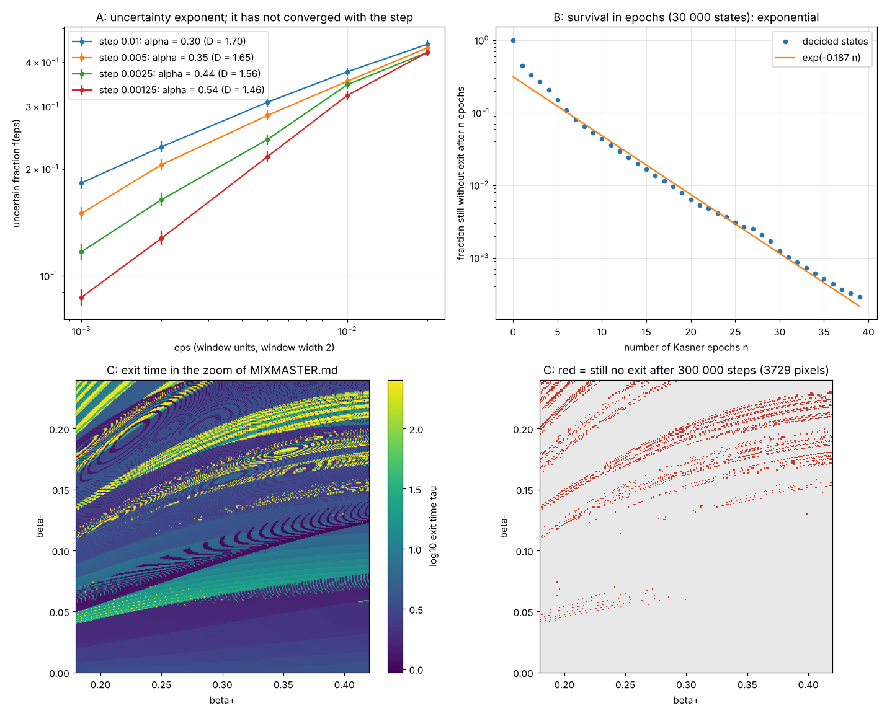

# Mixmaster exit basins

Module `lakes_of_wada/mixmaster.py`, tests `tests/test_mixmaster.py` (5 tests, about 20 s), figure `figures/mixmaster.png` (`figures/make_mixmaster.py`, about 3 minutes),
numbers `figures/mixmaster_profiles.csv`; boundary dimension and islands in `figures/analyse_mixmaster.py` (about 25 minutes), `figures/mixmaster_analysis.png`, `.csv`. This is the first system of the checklist in `PHYSICS.md` section 5 that is not a particle in a plane: the vacuum Bianchi IX
("Mixmaster") universe, whose spatial slices are three-spheres with three scale factors a, b, c (a Berger sphere when two are equal, the odd axis being the Hopf fibre;
see `brentharts/HopfFibration`, `hopf_berger.py` and `hopf_pancake.py`).

## 1. The system

With q_i = a_i^2, x_i = ln q_i and the BKL time tau (dt = abc dtau), the field equations are x_i'' = (q_j - q_k)^2 - q_i^2 for (i, j, k) cyclic, i.e. Cornish and Levin's
(ln a^2)'' = (b^2 - c^2)^2 - a^4 ([gr-qc/9709037](https://arxiv.org/abs/gr-qc/9709037), eq. 1). **Found numerically** (random initial data, residual 1e-10; a test): the
quantity I = sum_{i<j} x_i' x_j' - V with V = sum q_i^2 - 2 sum_{i<j} q_i q_j (their eq. 2) is conserved, and I = 0 is the Hamiltonian constraint. Between bounces V is
negligible and the motion is a Kasner epoch, x_i' = S p_i with sum p = sum p^2 = 1. The Mixmaster never leaves: it bounces for ever (the BKL map, `qgl_bkl.py` in
`brentharts/Quantum_Gravity_Lab`).

**The exit rule is ours, not Cornish and Levin's.** They cut pockets in the three corners of the potential in the anisotropy plane and found fractal boundaries between the
three outcomes. The review text we could read does not give the pocket geometry, the slice, or the energy. Our rule uses Kasner quantities only: a trajectory exits through
axis i at the first step with S < 0 (collapsing), |V| < 1e-3 sum x'^2 (curvature negligible) and p_i > 0.95 (axis i carries almost all the expansion rate, a Kasner epoch with large
Lifshitz-Khalatnikov parameter u). p_i tends to 1 in the **pancake** limit a_i ~ t, a_j and a_k constant: a Berger sphere whose collapsing axis is the Hopf fibre. So the three exits
are three pancakes, one per axis of SU(2). (A reading, not a theorem: the leading-order pancake of `hopf_pancake.py` is R_1 = a0 t, R_2 = b0.)

**The slice.** The moment of maximum expansion: Omega = (1/6) sum x_i = 0, S = 0, and an anisotropic velocity of magnitude fixed by the constraint, |beta'|^2 = -V/3, pointing radially
outward from the isotropic point. This needs V < 0, which is the triangle with three channels in the picture (grey = V >= 0, not a state). The family is invariant under the cyclic
permutation of the axes, so the picture has a three-fold symmetry. It is one natural two-parameter slice of a 4D reduced space; Cornish and Levin's slice may differ.

## 2. Results (all **Counted**, fixed-step RK4 with step 0.01/(1 + max|x'|))

| check | result |
|---|---|
| three-fold symmetry: rotating the initial state by a cyclic permutation permutes the labels | 979 of 979 points |
| constraint along trajectories (sampled every 1000 steps, relative) | below 2e-5 |
| three exits | K = 3 at every resolution |
| Wada profile, fraction of boundary pixels seeing all three exits within r pixels, 100 / 200 / 400 grid, r = 4 | 1.000 / 0.995 / 0.960 |
| same, r = 8 and r = 16 | 1.000, 0.9998, 0.9992 and 1.000 at 16 |
| needed radius in window units (window width 2.4), median / 90th / 99th percentile at 100, 200, 400 | 0.034 / 0.054 / 0.076, then 0.017 / 0.027 / 0.043, then 0.012 / 0.019 / 0.032 |
| zoom (window width 0.24, 300 x 300) and zoom (width 0.06, 300 x 300), median / 90th / 99th percentile in window units of the full picture | 0.0036 / 0.0115 / 0.0205, then 0.0029 / 0.0050 / 0.0066 |
| the biaxial line beta_- = 0 (b = c, a Berger sphere) | all 25 test points exit through its own axis; a solid band of that colour, half-width 0.01 to 0.06 in beta_-, surrounds the line in the picture |
| step size 0.01 against 0.005, 3000 random initial states | 90 % of decided points agree |
| exit thresholds p_exit 0.9 / 0.99 and kappa 1e-4, against the defaults | 81 % / 77 % / 73 % agree; the Wada profile is unchanged (K = 3, r = 8 gives 1.0) |

Reading. The needed radius shrinks in physical units, from 0.012 to 0.003 (median) over a 40-fold change in pixel size, but much more slowly than the pixel: at the finest zoom the median
needs 15 pixels. So the safe statement is that every boundary pixel sees all three exits within a small, slowly shrinking distance, not that the property is confirmed at the pixel scale at
every depth. For comparison the 2D Newton and Hénon-Heiles pictures of this repository reach the pixel scale. Section 2b measures the boundary dimension and looks for islands.

## 2b. Boundary dimension and stability islands (`figures/analyse_mixmaster.py`, `figures/mixmaster_analysis.png`, `.csv`; all **Counted**)

**Dimension: not determined.** The uncertainty fraction f(eps), the fraction of states whose exit axis changes when the state is moved by eps in a random direction, behaves like eps^alpha and
gives the boundary dimension D = 2 - alpha. With 4000 states in the window |beta| < 1 and the same perturbations for each step size:

| RK4 step h0 | f at eps = 0.02, 0.01, 0.005, 0.002, 0.001 | alpha | D = 2 - alpha | disagreement of h0 against h0/2 on the unperturbed states |
|---|---|---|---|---|
| 0.01 (default) | 0.449, 0.376, 0.308, 0.231, 0.183 | 0.30 | 1.70 | 0.096 |
| 0.005 | 0.439, 0.353, 0.283, 0.206, 0.150 | 0.35 | 1.65 | 0.083 |
| 0.0025 | 0.426, 0.346, 0.242, 0.164, 0.117 | 0.44 | 1.56 | 0.055 |
| 0.00125 | 0.426, 0.323, 0.217, 0.128, 0.087 | 0.54 | 1.46 | not measured |

The integration error inflates f at small eps, which lowers alpha and raises D, so each row is an upper bound on D for what the integrator resolves, and the bound is still falling at the smallest step
(each fit covers only one decade, eps 0.001 to 0.02, and the log-log curves bend). **Not converged: we cannot give a dimension**, only that it is below 1.7 and probably well below. Cornish and
Levin's 1.86 +/- 0.02 is an information dimension of their boundaries (their slice, pockets and exit rule); the two numbers are not comparable and this does not test theirs. A converged value needs a
higher-order or adaptive integrator.

**Islands: no evidence, and the picture argues against them.**
1. The number of Kasner epochs a trajectory passes before exiting has an exponential distribution: of 30 000 states, the fraction still without exit after n epochs falls as exp(-0.187 n) over three decades (n up to 39).
   Stability islands would give a plateau or a power law.
2. The roughly 8 % of states that have not exited after 100 000 steps have completed only 6 epochs (median; at most 18) and reached BKL time tau of about 900 (median): they are inside very long
   Kasner epochs (the scale factors are tiny and the expansion rate S is about -0.1), not trapped. The fraction without exit decreases slowly as the budget grows: 0.101, 0.081, 0.068 after 30 000, 100 000, 300 000 steps.
3. In the zoom, of the 5461 pixels without exit at 30 000 steps, 3729 (68 %) still have none at 300 000, but they lie along thin curves, the stripes of long exit times at the basin boundaries in the exit-time map
   (panel C), not in filled regions: 1181 connected components, the largest with 176 pixels. Islands would be compact blobs of pixels without exit.
4. The closed "eyes" in the zoom are nested closed bands of exit axis and exit time (panel C, left); in the map of pixels without exit (panel C, right) they do not appear as filled regions.

What this does not exclude: islands smaller than a pixel of the zoom (0.0008 in beta), or a power-law tail slower than the budgets reach. The statement is that none is visible at these scales and the survival law is exponential.

### 2c. The exit rule depends on the step; a persistent rule does not (`exit_basins_persistent`)

**Counted, and a correction to section 2b.** With an 8th order integrator (Dormand-Prince coefficients, step 0.2 down to 0.003 of BKL time) the labels of `exit_basins` still change by about 9 to 12 % between
step halvings, so integrator order was not the limit. In 600 states, 43 changed label between steps 0.0125 and 0.00625, and in 93 % of those the finer step found an exit at tau of about 1 to 3 where the coarser one
found it at tau of 7 to 117: the rule 'first sampled step with |V| < kappa sum x'^2, p_i > 0.95, S < 0' catches brief near-Kasner passes only if the sampling hits them. So the step dependence of section 2b is mostly a
property of the rule, not of the integrator error, and the dimension bounds of 2b should be read with that in mind.

The persistent rule requires the condition to hold for 2 units of BKL time (`tmin`). On 1000 states the labels are identical for steps 0.1, 0.05, 0.025 and 0.0125, for tmin = 1 and 5. The price: only 43 % of states have a
persistent exit before tau = 300 (38 % for tmin = 5); the rest are inside long Kasner epochs or between bounces and are labelled 0.

Uncertainty fraction f(eps) with this rule (6000 states, pairs with both ends decided; 8th order, steps 0.1 and 0.05 agree to 3 decimals):

| eps | 0.02 | 0.01 | 0.005 | 0.002 | 0.001 | 0.0005 |
|---|---|---|---|---|---|---|
| f | 0.630 | 0.547 | 0.542 | 0.373 | 0.144 | 0.055 |

This is **not a power law**: f saturates near 0.55 to 0.63 for eps of 0.005 and above (the perturbation is then larger than the basins) and falls by a factor 2.6 per halving at the smallest eps, a slope of about 1.4, which would
mean 'D < 1' and is impossible for a boundary. The likely reason is selection: states near a boundary have long exit times, so they are the ones the rule labels 0 and removes from the sample, and that depletes exactly the
pairs that would disagree. A fit of the whole range gives D = 1.56 and of eps >= 0.002 gives D = 1.79, with the same values for tmin = 5 within 0.02; neither is a dimension. **We still cannot give a boundary dimension.** What is
now established is that the labels are step independent under this rule; the missing piece is a dimension estimate that does not drop undecided states, for example by counting a state as uncertain when either end is
undecided, or by a box-counting of the boundary pixels on a grid with a larger tau budget. Not done.

### 2d. Uncertainty fraction with undecided states kept (`figures/analyse_persistent.py`)

**Counted.** Persistent rule (tmin = 2), 3000 states, step 0.1, three budgets in BKL time. 'differ' counts a pair as uncertain when the labels differ with 'undecided' as a fourth label (undecided with undecided agrees);
'either0' is the literal version, uncertain when the labels differ or at least one end is undecided. U is the fraction of states with no persistent exit.

| tau budget | U | f(eps) 'differ' at eps = 0.02, 0.01, 0.005, 0.002, 0.001, 0.0005 | alpha, eps <= 0.002 | D |
|---|---|---|---|---|
| 300 | 0.573 | 0.572, 0.567, 0.546, 0.482, 0.397, 0.275 | 0.41 | 1.59 |
| 1000 | 0.443 | 0.681, 0.662, 0.626, 0.591, 0.515, 0.407 | 0.27 | 1.73 |
| 3000 | 0.349 | 0.722, 0.701, 0.678, 0.645, 0.574, 0.481 | 0.21 | 1.79 |

The undecided fraction falls roughly as budget^(-0.21) between 300 and 3000, a slow power law in tau (the exponential law of 2b is in the number of epochs, which grow in tau). Every f(eps) rises with the budget, the
local slope at the smallest eps falls (0.53, 0.34, 0.26) and the fitted D rises, 1.59 to 1.73 to 1.79. The 'either0' version gives alpha near 0.13 to 0.15 (D about 1.86) at all three budgets, but it carries a floor from the
undecided states (every pair with an undecided end is uncertain for every eps), which flattens the curve and biases D upward; its agreement with 1.86 should not be taken as a measurement.

**What this supports and what it does not.** The trend is monotone and the estimate moves towards the 1.86 of Cornish and Levin, but neither f(eps) nor D has stopped moving with the budget, the slope is still steepening at
the smallest eps, and the fit range is one decade. No converged dimension; the statement is only that the persistent-rule estimate rose from 1.59 to 1.79 as the budget grew tenfold. Larger budgets cost roughly in proportion
(3000: 325 s for 3000 states), and a power-law U means the undecided set shrinks slowly.

### 2e. Reduced-word coding of the exit basins (`exit_words`, `figures/analyse_words.py`)

A trajectory's bounces form a word in the walls 1, 2, 3 (a bounce off wall i is x_i' going from + to -); consecutive letters always differ (0 repeats in 36 741 consecutive pairs), so it is a reduced word of the (inf,inf,inf) reflection group of
`brentharts/HopfFibration` `HOPF_BKL.md`. The persistent exit rule of 2c is used, so the labels do not depend on the step. Counted on a 160 x 160 grid of (beta_+, beta_-) on [-1,1]^2: 9302 valid states, 4020 decided (43 %), median word length 7.

1. **The exit axis is the last letter in 86.7 % of the decided states** (3486 of 4020). The exceptions are mostly the letter before the last (for example, last two letters 1, 2 with exit 1: 57 states).
2. **The label is carried by the tail, not by the head.** H(label) = 1.585 bits. Given the last k letters it falls to 0.70 (k = 1), 0.66 (3), 0.52 (5), 0.38 (6); given the first k letters it stays near the maximum: 1.58, 1.54 (3), 1.46 (5), 1.40 (6).
   Plug-in entropies from groups of at least 20 states, biased low by roughly 0.07 bits, and the groups that are large enough get fewer as k grows (4020 states at k <= 3, 2822 at k = 6 for the tail).
3. **The cylinders of the first bounces are smooth wedges, and each contains all three exits.** The first k bounces cut the plane into 3 * 2^(k-1) cylinders (12 at k = 3; panel 2 of `figures/mixmaster_words.png`: sectors around the symmetric point, with the stripes along
   the Taub lines). Counting cylinders with at least 30 states in which each of the three exits has at least 10 %: 3 of 3 (k = 1), 6 of 6 (2), 12 of 12 (3), 22 of 24 (4), 26 of 36 (5), 12 of 38 (6), 8 of 20 (7).
   At k >= 5 only the larger cylinders have 30 states, so the drop is a sample-size effect as much as a property of the system; a larger grid (`python3 figures/analyse_words.py 320`, which takes several times as long) is needed to tell.

What this says: the first few bounces, which decide which wedge a state lies in, say almost nothing about the exit, and each wedge down to the fourth bounce meets all three basins. That is the symbolic form of the intermingling of 2a. What it does not say:
the Wada property in the plane needs the boundary of each basin to equal the common boundary, which this coding does not test; and 57 % of the valid states have no persistent exit before tau = 300 and are absent from these counts.

## 3. What this says and does not say

- **Says.** For this slice and this exit rule the three outcomes (which axis becomes the collapsing Hopf fibre of the final pancake) intermingle at every scale we resolved, with a profile that
  reaches 1 within about 8 pixels. The picture is robust in structure to the exit thresholds and the step size; individual pixels near boundaries are not (section 2c: the first-hit rule itself depends on the step).
- **The Hopf/Berger line is not where the mixing is.** The Taub solutions (b = c, the Berger spheres) are an invariant manifold; they stay biaxial (the equations preserve b = c) and exit through their own axis, and the
  fractal region starts at a positive distance from them. In the Hopf repository's language: the exact Berger slices are inside a basin, and the chaos lives where all three axes differ.
- **Does not say.** That the true Mixmaster (without our exit rule) has Wada exit sets; that our slice is the one used in the literature; anything about the quantum or the physical (not
  minisuperspace) problem. The invariant set, the periodic orbits and the Farey map are not touched.

## 4. Next

1. Add the energy-like slice of Cornish and Levin once their paper text is available, and compare labels.
2. A converged boundary dimension: sections 2c and 2d remove the step dependence and keep undecided states, and the estimate rises with the budget (1.59, 1.73, 1.79) without converging; the next step is a budget of 10^4 or more, with eps down to 10^-4.
3. The Hopf side of this picture is in `brentharts/HopfFibration` (`HOPF_BIANCHI.md`): the three exits are the three left-invariant Hopf fibrations of S^3 = SU(2).
