# wada-coudene

Dynamical Lakes of Wada: pictures, Wada tests and exploration tools, in pure
numpy/scipy (the original Sage scripts are kept for reference; see
[About](#about) below). All figures here are regenerated by
`python3 figures/make_figures.py`; the numbers quoted come from
[`figures/wada_profiles.csv`](figures/wada_profiles.csv) and
[`figures/wada_merging.csv`](figures/wada_merging.csv).

## Figures

Two quantities are used throughout. The **Wada profile** is the fraction of
boundary pixels that have *all* basins within r pixels; the **merging distance**
merges all basins but one and measures (Hausdorff distance, as a percentage of
the image diagonal) how far apart the resulting boundaries are: near 0 if every
basin has the same boundary. Both are resolution-limited: they show the property
at the scale of the picture, not a proof, and they cannot tell a Wada set from a
"slim fractal" that is Wada only down to the pixel size.

### 1. The torus, four lakes (`torus.png`)

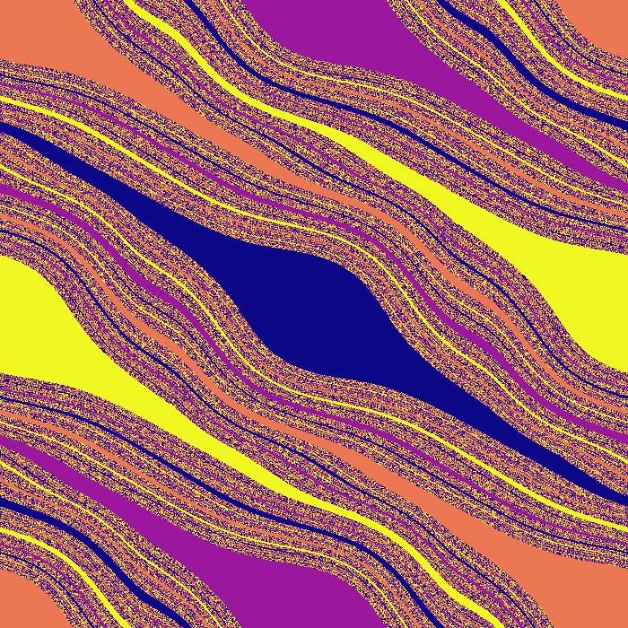

Coudène's picture: a perturbed cat map on the 2-torus (amplitude 2.2, spread
0.23, 700x700). The origin is an attracting fixed point; the other three
2-torsion points form an attracting **period-3 cycle**, (0,1/2) -> (1/2,1/2) ->
(1/2,0). The four lakes are the basin of the origin plus the basins of the three
cycle points under f^3, which is what the cyclic colouring rule draws. Each lake
has a large solid core, and between the cores is a band where all four colours are
interleaved at every scale we can resolve. At this resolution 99% of boundary pixels see all four
lakes within 4 px (0.57% of the width), and the merging distance is 5.1 px
(0.52% of the diagonal). The image keeps the original scripts' orientation (the
array is indexed `[x, y]`, so the picture is transposed).

### 2. The plane (`plane.png`)

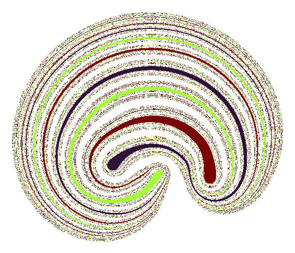

The same dynamics seen through the inverse Weierstrass function: each point z of
a window of the plane (radius 4, rotated 1.7 rad, 800x800; cropped here) is
coloured by the lake of the torus point w with P(w) = z. White is the basin of the origin, which includes the unbounded outer
region; the three colours are the cycle lakes. They wind through each other as
nested spirals. The profile reaches 0.99 at 6 px (0.75% of the width) and the
merging distance is 7.1 px (0.63% of the diagonal), slightly coarser than the
torus picture (0.57%).

### 3. Newton's method for z^3 - 1 (`newton.png`)

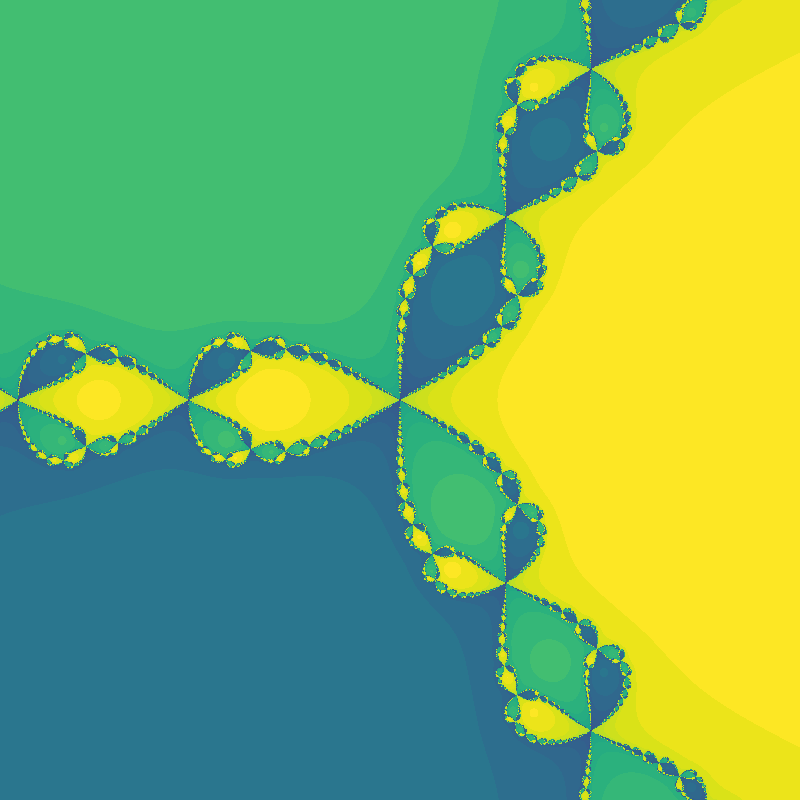

The standard example of a Wada boundary in complex dynamics: three root basins
that share one boundary (window |z| <= 1.5, 800x800; brightness encodes
convergence speed). Every point of the boundary is a limit of all three basins;
in the figure, the bulbs along the boundary contain copies of all three colours. We use it as the **positive control** for the Wada tests (0.99
at 4 px, 0.5% of the width; merging distance 4.5 px, 0.40% of the diagonal), and
it is one of the test systems in the Wagemakers-Daza-Sanjuan review.

### 4. Henon-Heiles exit basins (`henon_heiles.png`)

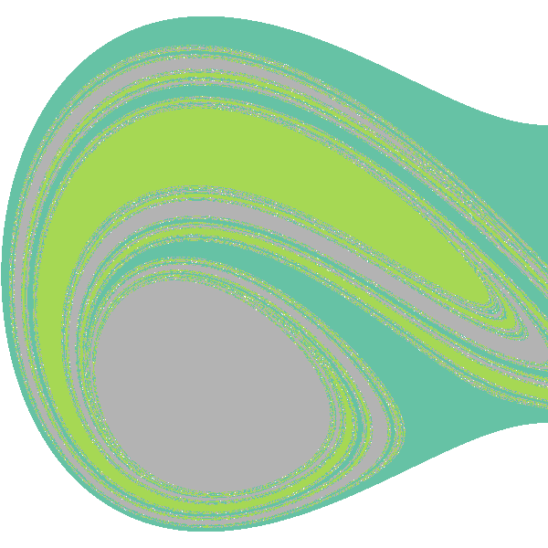

A continuous-time example: the Henon-Heiles Hamiltonian at energy E = 0.25, above
the escape energy 1/6, so there are three exits. Each pixel is an initial condition
on the surface x = 0 with p_x >= 0, in the plane (y, p_y), coloured by the exit
the trajectory leaves through (600x600; white = not allowed at this energy). The
three exit basins wrap around each other in a spiral. Both tests say Wada (0.99 at
4 px, 0.67%; merging distance 5.0 px, 0.59%), consistent with Aguirre, Vallejo
and Sanjuan, who show that the exit basins of this system are Wada. The same tests run in 3D on the full energy surface
(`wada.py scatter --dim 3`).

### 5. The canal construction (`canals.png`)

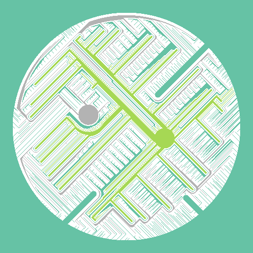

The classical Wada/Yoneyama construction made literal on a 512x512 raster: an
island with a surrounding sea and two ponds; stage k digs lake (k mod 3) through
the remaining land, and every stage uses thinner canals and a smaller tolerance
than the one before so that the land corridors stay wide enough for the next lake.
White is the remaining land. It is the *honest* counter-example in this set: a
finite raster can only run a few stages, and the profile reaches 0.95 only at 48 px
(9.4% of the width), with merging distance 57 px (7.9% of the diagonal). It is
Wada down to roughly that scale and no further, whereas the dynamical pictures are
Wada down to a few pixels.

### 6. Maverick points on the torus (`maverick.png`)

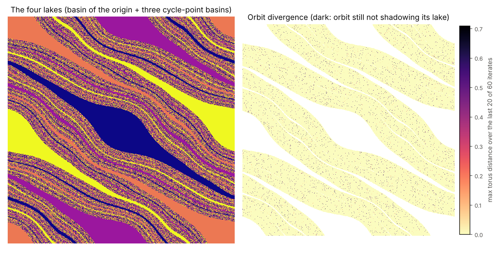

An experimental use of the maverick-point idea of Marti-Pete, Rempe and Waterman.
Left: the four lakes. Right: for each boundary pixel, the largest distance over
iterates 40-60 between its orbit and that of the nearest *settled* interior pixel
of its own lake (dark = large; the maximum possible torus distance is 0.707).
Result: only 1.7% of the 356,338 evaluated pixels score above 0.1, scattered
through the interleaved band rather than concentrated anywhere, and every one of
them is a pixel whose orbit takes more than 40 steps to settle. All 490,000 pixels
are eventually captured within the 500-step budget, so there is **no** persistent
"never converges" set visible at this resolution. The detector measures long
transients, which is a proxy for being near the boundary, not evidence of
maverick points in the paper's sense (those live on a measure-zero set that a pixel
grid cannot reach).

### 7. All the Wada profiles together (`wada_profiles.png`)

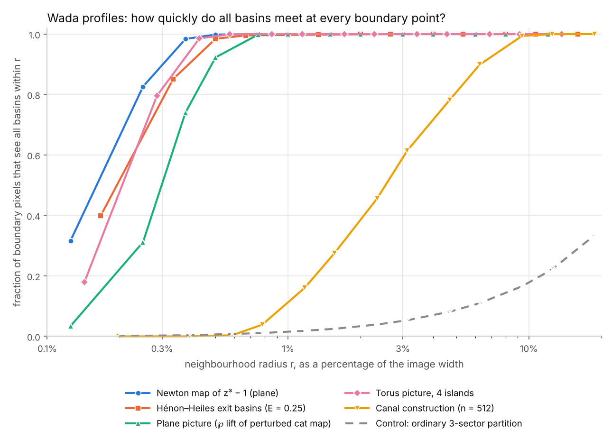

The four dynamical pictures (Newton, Henon-Heiles, torus, plane) all reach 0.99
within 0.75% of the image width, and their curves are close together. The two
remaining curves are informative: the canal construction rises late, as
above, and an ordinary three-sector partition, in which the basins meet only at a
single point, never gets above 0.33 even at 19% of the width, with merging
distance 295 px (41% of the diagonal): the boundaries of its three basins are
all about equally far from one another, so they are clearly different sets and the
partition is not Wada. The underlying numbers are in
[`figures/wada_profiles.csv`](figures/wada_profiles.csv).

### 8. Energy dependence of Wada-ness (`energy_strip.png`, `energy_sweep.png`)

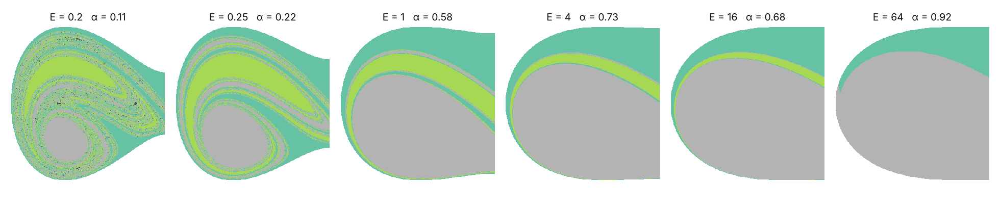

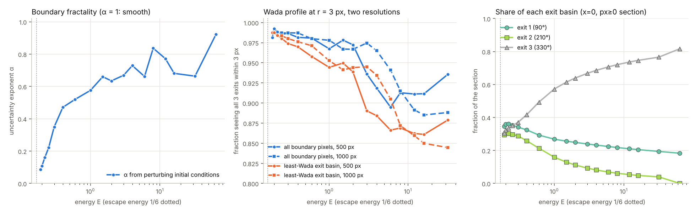

Fernandez et al. (see Related work) report a three-dimensional scattering system
in which Wada-ness disappears above a critical energy. Henon-Heiles is a different
system (two degrees of freedom, a 2D position space), so this sweep does **not**
test or reproduce their result. It asks only what the same diagnostics do as the
energy rises from just above the escape energy 1/6 up to E = 64
(`wada.py sweep`; data in [`figures/energy_sweep.csv`](figures/energy_sweep.csv)).
The strip shows the x = 0, px >= 0 section (dark = still trapped at t_max, the
three greens/grey = exits); the exit colours follow figure 4.

What the numbers show:

* **The boundary stops being strongly fractal.** The uncertainty exponent alpha
  (measured by perturbing initial conditions, as in Aguirre et al.) rises from
  about 0.09 at E = 0.19 to about 0.6-0.8 above E = 1, and 0.92 at E = 64.
  Near the escape energy the basins are tightly interleaved; at high energy the
  section is dominated by a few large smooth regions.
* **Exit 2 gradually vanishes from the section.** Its share falls from 0.30 to
  0.04 at E = 32 and to exactly 0 at E = 64, so the
  three-basin Wada test is undefined there (the `nan` entries).
* **The Wada profile degrades, but not cleanly.** At r = 3 px about 0.98-0.99 of
  boundary pixels see all three exits for E <= 0.6, falling to about 0.89-0.94
  for E >= 3; the least-Wada single basin falls further, to about 0.85-0.88.
  The two resolutions disagree on the trend at high E (the 1000 px values are
  lower than the 500 px values there, whereas below E = 3 they are similar),
  which is the signature of boundaries that are becoming smooth, thin
  structures rather than of a clear transition. There is no sharp critical
  energy in these data.

Caveats: this is one section of a 3D energy surface, the section is asymmetric
(exit 3 takes 82% at E = 64), the tests are resolution-limited, and a fraction
below 1 at a few pixels is not a proof that a boundary is non-Wada. The honest
reading is "consistent with weakening Wada-ness at high energy, no sharp
threshold", not a reproduction of the 3D result. A weakly dissipative
Henon-Heiles variant, which adds a trapped fourth basin, would be the closer
analogue and is a natural next experiment.

### 9. More exit channels: the harmonic-polynomial family (`degree_strip.png`, `degree_sweep.png`)

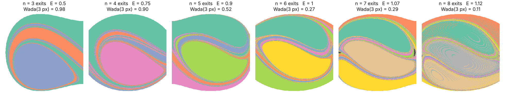

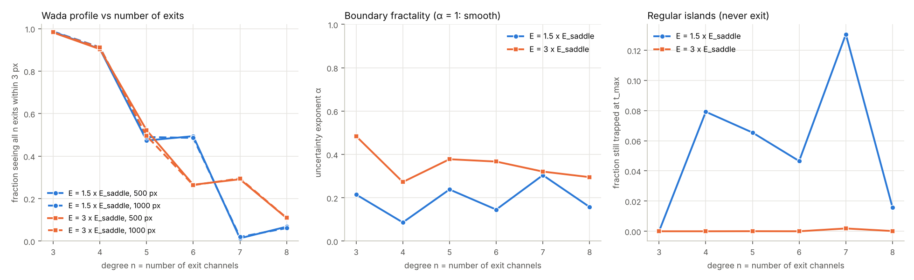

Henon-Heiles is the cubic member of the family V = r^2/2 + Im(z^n)/n, which has
n exit channels (the "harmonic polynomial potentials" that the pp-wave
geodesic problem of Rossetto et al. reduces to; see Related work). Each degree
is run at a common *relative* energy, E = 1.5 x E_saddle or 3 x E_saddle, where
E_saddle = 1/2 - 1/n is the energy at which the channels open (`wada.py sweep
--degrees 3,4,5,6,7,8`; data in `figures/degree_sweep_r1.5.csv` and
`figures/degree_sweep_r3.csv`). The question was whether Wada-ness is special to
three basins (colours). The strip shows the section at 3 x E_saddle.

* **Three is not special in the sense of Wada-ness existing.** Every degree has
  strongly intermingled boundaries (uncertainty exponent between 0.09 and 0.48
  for every case, with no trend in n), and the pictures show the same
  structure: a few large smooth regions plus a band where all the colours
  interleave.
* **The fraction of the boundary that is Wada-like falls steeply with n.** At
  3 px the fraction of boundary pixels that see all n exits is 0.98 for n = 3,
  0.90 for n = 4, about 0.5 for n = 5, 0.27-0.49 for n = 6, and 0.01-0.29 for
  n = 7, 0.07-0.11 for n = 8 (the ranges are the two energies). At 6 px most of
  them recover (0.75-0.99 for n <= 6 at 3 x E_saddle), so the exits are close
  to every boundary point, but not within the 3 px scale.
* **It is not a resolution effect.** The values at 500 px and 1000 px agree
  within a few hundredths, whereas a smooth two-basin boundary would lose its
  value as the grid is refined. The reading is that a fixed fraction of the
  boundary is a scale-invariant mixing core where all n exits intermingle, and
  the rest is smooth boundary between two large basins. That fraction decreases
  as channels are added.

What this does and does not show: this measures the fraction of *all* boundary
pixels in one 2D section of one energy surface, which includes the smooth
two-basin boundaries between the big regions. It does not test whether the
mixing core by itself is Wada, so it neither confirms nor contradicts the
robustness reported by Rossetto et al. (whose full text I could not read). Some
details are unexplained and I have not chased them: degree 7 is much lower at
1.5 x E_saddle (with 13% regular islands), and the trapped regular islands (5-13% for n = 4 to 7
at 1.5 x E_saddle, under 0.2% at 3 x E_saddle) are excluded from these numbers
(`*_exits` columns; the all-points versions are in the CSVs). Pixel values near
the boundary also depend on the integration step (about 86-98% of the section
agrees between dt = 0.05 and a much finer step), so statistics, not individual
pixels, are what to trust. A first follow-up would be to restrict the test to
the mixing band.

## About

Python/Sagemath scripts to make pictures of "Lakes of Wada" sets in the plane and in the 2-torus, using the method described by Yves Coudene in [Pictures of Dynamical Systems, Notices of AMS 53, No 1, pp8-13](http://www.ams.org/notices/200601/fea-coudene.pdf).

## Author

* [David Dumas ](http://dumas.io/)

## License

This project is licensed under the MIT License - see the [LICENSE](LICENSE) file for details.

## Rewrite (numpy/scipy, no Sage)

`wada-plane.py` and `wada-torus.py` are kept unchanged as reference. The
maintained code is the `lakes_of_wada/` package plus the `wada.py` front end:

    python3 wada.py torus -n 400 -o torus.png
    python3 wada.py plane -n 400 -o plane.png --data plane.npz   # also save raw arrays

Package layout: `maps` (Anosov map + pluggable perturbations), `classify`
(orbit/basin classification, colouring rules), `views` (pixel -> torus point),
`elliptic` (inverse Weierstrass P via scipy), `pipeline` (glue). Run tests with
`python3 -m pytest tests`.

### Analysis tools and plane dynamics

    python3 wada.py entire --family newton --degree 3 -n 600 --wada   # basins of z^3-1 + Wada profile
    python3 wada.py entire --family exp --lam 0.3 --radius 5 -o exp.png
    python3 wada.py torus -n 400 --maverick mav.png                   # orbit-divergence map
    python3 wada.py canal -n 256 --wada                               # canal construction
    python3 wada.py scatter -n 500 --energy 0.25 --wada --merging     # Henon-Heiles exit basins
    python3 wada.py scatter -n 64 --dim 3 --data hh3d.npz --wada      # 3D energy surface
    python3 wada.py sweep --energies 0.2,1,4,16 -n 500 --csv sweep.csv # Henon-Heiles energy sweep
    python3 wada.py scatter --system harmonic --degree 5 --energy 0.9 -n 500   # 5 exit channels
    python3 wada.py sweep --degrees 3,4,5,6 --ratio 3 -n 500 --csv deg.csv      # vs number of exits

* `lakes_of_wada.wadatest`: numerical Wada tests on a label array of **any
  dimension** (2D images, 3D volumes, ...). Labels: `>0` basins, `0` undecided
  (counted as boundary), `<0` invalid/outside the domain (ignored).
  * *Wada profile* (`--wada`): fraction of boundary points that see all K basins
    within r pixels; `basin_profile` does it per basin, to expose partially Wada
    sets. Verified controls: Newton for z^3-1 reaches ~1.0 by r = 4 px, an
    ordinary 3-sector partition stays near 0.
  * *Merging method* (`--merging`, after the Wagemakers-Daza-Sanjuan review):
    merge all basins but one, compare the resulting slim boundaries by Hausdorff
    distance. Judge by `max_d_normalized` (small = Wada) as well as by the
    ratio: a plain 3-sector partition has nearly identical boundaries
    (ratio ~ 0) but they sit ~40% of the diagonal apart.
* `lakes_of_wada.scattering`: continuous-time open systems. A vectorized RK4
  integrator with an exit classifier gives exit basins; Henon-Heiles (`E > 1/6`,
  three exits) is included, both as the 2D section x = 0 in (y, p_y) and as the
  full 3D energy surface. Validated against scipy's DOP853 and for energy
  conservation. At E = 0.25 the exit basins come out Wada by both tests, in 2D
  (profile 0.995 at r = 4 px, merging distance 0.8% of the diagonal) and in 3D
  at 48^3 to 64^3 (profile 0.98 at r = 3 voxels).
* `lakes_of_wada.sweep`: `hh_energy_sweep` runs the Henon-Heiles section at a
  list of energies (using `scattering.energy_window` for the allowed region and
  `scattering.uncertainty_fraction` for the uncertainty exponent) and returns one
  row of diagnostics per energy; `write_csv` saves them. `harmonic_degree_sweep`
  does the same across the harmonic-polynomial family (`scattering.harmonic_polynomial`),
  which has `degree` exit channels and contains Henon-Heiles as degree 3.
* `lakes_of_wada.maverick`: per-pixel *orbit divergence*: the largest distance
  over a late window of iterates between a boundary pixel's orbit and the orbit
  of the nearest settled interior pixel of each basin (a finite-window proxy for
  the limsup in the maverick-point definition below). Treat it as a heat map:
  the maps are chaotic, so double-precision orbits are only pseudo-orbits.
* `lakes_of_wada.entire`: maps of the complex plane (Newton, polynomial, `exp`,
  `sin`; any vectorized callable works), classified into escape / attracting
  cycle / undecided, with the chordal metric for the analysis tools.
* `lakes_of_wada.construction`: Wada-style canal construction on a raster (sea
  plus ponds; stage k digs lake k mod K with shrinking tolerance and canal
  width). Resolution-limited: at n = 512 the Wada profile is 0.61 at r = 16 px,
  0.90 at r = 32, 1.00 at r = 64; larger n goes deeper.

## Related work

* D. Martí-Pete, L. Rempe, J. Waterman, *Eremenko's conjecture, wandering Lakes
  of Wada, and maverick points*, J. Amer. Math. Soc. (arXiv:
  [2108.10256](https://arxiv.org/abs/2108.10256)). Constructs transcendental
  entire functions with infinitely many Fatou components sharing a common
  boundary (Lakes of Wada continua), and introduces *maverick points*: boundary
  points of a wandering domain whose orbits accumulate somewhere the domain's
  own iterates do not. Their Figure 1 is the Plykin attractor, the perturbed
  Anosov torus map drawn here.
* A. Wagemakers, A. Daza, M. A. F. Sanjuán, *How to detect Wada basins*
  (arXiv: [2005.05923](https://arxiv.org/abs/2005.05923)). Review of four
  detection methods, each built on a different characterization of the Wada
  property: Nusse-Yorke (unstable manifolds of periodic orbits), the *grid*
  method (refine until a third colour appears between two others), the *merging*
  method (merge all other basins into one colour and compare the resulting
  boundaries by Hausdorff distance) and *saddle-straddle* (compare the chaotic
  saddles found for each basin versus the rest). Newton's method with 3 to 6
  roots is among its test systems.
* J. Aguirre, J. C. Vallejo, M. A. F. Sanjuán, *Wada basins and chaotic
  invariant sets in the Hénon-Heiles system*, Phys. Rev. E 64, 066208 (2001),
  [doi:10.1103/PhysRevE.64.066208](https://doi.org/10.1103/PhysRevE.64.066208).
  Shows by several computational methods that the exit basins of this open
  Hamiltonian are Wada, not just fractal. (Cited from its listing; the journal
  page was not readable when this entry was written.)
* D. S. Fernández, J. M. Seoane, M. A. F. Sanjuán, *Weak dissipation drives and
  enhances Wada basins in three-dimensional chaotic scattering*
  (arXiv: [2202.03069](https://arxiv.org/abs/2202.03069)). In a 3D open
  Hamiltonian system the basins stop being Wada above a critical energy, and
  weak dissipation turns non-Wada basins into partially Wada ones.
* Á. Daza, J. O. Shipley, S. R. Dolan, M. A. F. Sanjuán, *Wada structures in a
  binary black hole system*, Phys. Rev. D 98, 084050 (2018),
  [doi:10.1103/PhysRevD.98.084050](https://doi.org/10.1103/PhysRevD.98.084050)
  (arXiv: [1807.10741](https://arxiv.org/abs/1807.10741)). Treats the shadow of
  a binary black hole as exit basins of an open Hamiltonian system and uses a
  numerical Wada-detection algorithm to show parts of the shadow have the Wada
  property, separating fractal regions from regular ones.
* P. Pankka, J.-M. Wu, *On Lakes of Wada* (arXiv:
  [2601.02266](https://arxiv.org/abs/2601.02266)). Shows Lakes of Wada exist in
  the sphere S^n for every n >= 3, with lakes that are quasiconformally
  equivalent to a ball and are John domains.
* P. H. B. Rossetto et al., *Robust Wada boundaries and entropy scaling in
  pp-wave spacetimes*, Chaos 36, 063136 (2026),
  [doi:10.1063/5.0336333](https://doi.org/10.1063/5.0336333). Geodesics of
  pp-wave spacetimes with polynomial profiles are equivalent to a particle in a
  2D harmonic polynomial potential (Henon-Heiles is the cubic case). The
  abstract reports that the Wada property of the escape basins is robust as the
  polynomial degree, and so the number of escape channels, increases. (Read from
  the journal abstract only; the full text was not available.)
* R. C. Pantig, *Symbolic dynamics of multi-black-hole photon scattering*,
  Physica D (December 2026),
  [doi:10.1016/j.physd.2026.135415](https://doi.org/10.1016/j.physd.2026.135415).
  Listed here from its title and the journal's contents page; the abstract and
  full text were not available when this entry was written.
* A. Wagemakers, *Basins of Attraction: A Dynamical Zoo*, International Journal
  of Bifurcation and Chaos 35(11) (2025),
  [doi:10.1142/S0218127425300241](https://doi.org/10.1142/S0218127425300241).
  Same group (Universidad Rey Juan Carlos) as several entries above. Listed from
  the title, author and venue only; the abstract and full text were not
  available when this entry was written.
* Y. Coudène, *Pictures of Dynamical Systems*, Notices AMS 53 (2006), the
  method used by the original scripts.

