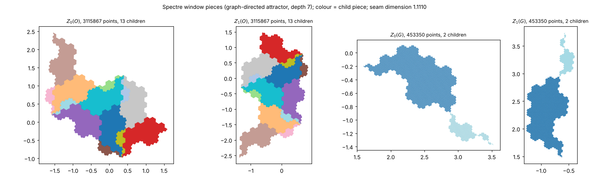

# Exit basins of homogeneous SU(2) Yang-Mills mechanics

Module `lakes_of_wada/yangmills.py`, tests in `tests/test_yangmills.py`, analysis `figures/analyse_yangmills.py` (about 8 minutes), figure `figures/yangmills.png`, numbers `figures/yangmills_analysis.csv`.
Labels: **Exact** (identity or test that can fail), **Counted** (a computed number with its conditions), **Not shown**, **Idea** (untested).
Section 6 (connections to Lockwood and Romanov) adds `wilson_potential` and `figures/analyse_wilson_yangmills.py`; references are in section 7; sections 8 and 9 are the Langevin Higgs toy and the three-variable model; section 10 is the connection to the spectre fork and section 11 the rasterised Spectre window pieces and section 12 the covering of internal space by neighbouring windows.

## 1. The system and what an exit is

H = (p_x^2 + p_y^2)/2 + x^2 y^2 / 2, the spatially homogeneous SU(2) Yang-Mills field in a two-variable truncation (Matinyan, Savvidy and others; not re-derived here). The scaling x -> s x, t -> t/s, E -> s^4 E lets us set E = 1.

The potential vanishes on the four half axes, so there are four valleys, of width about 1/|x|. A particle in a valley is not free: the transverse oscillation has frequency |x|, its adiabatic invariant J = E_transverse/|x| acts as a potential J|x| for the motion along the valley, so a given orbit is
turned back (this is a heuristic argument, not shown here). The system has no escape to infinity in the sense of the Henon-Heiles scattering of this repository. `PHYSICS.md` 4.3 item 2 says the same (that homogeneous Yang-Mills is bound and has no exits). What can be defined is a **first passage**: the label of an orbit is the half
axis (1: +x, 2: +y, 3: -x, 4: -y) on which it first crosses the circle of radius R. For R above (8E)^(1/4) = 1.68 the circle lies outside the allowed region x^2 y^2 < 2E except in the valleys, so the label is unambiguous. **The label depends on R**, and so does everything below: this is a family of
problems, not one exit-basin problem.

Initial conditions: the section x = 0 (V = 0 there for every y), (y, p_y) in [-2, 2] x (-sqrt 2, sqrt 2), p_x = + sqrt(2E - p_y^2). Integration by velocity Verlet.

- **Exact (tests).** The map has the symmetry (y, p_y) -> (-y, -p_y) with labels 2 and 4 exchanged (0 disagreements out of 400); energy drift below 1e-3 (about 1e-4 in the runs below); invalid states (p_y^2 >= 2E) are marked.

## 2. Counted results (E = 1)

| R | undecided (t_max) | neighbour agreement of labels, n = 200 (shuffled-label control) | step floor, dt 0.001 against 0.0005 | uncertainty exponent alpha (D = 2 - alpha) |
|---|---|---|---|---|
| 2 | 0 (60) | 0.87 (0.27) | 0.000 | 0.43 (1.57) |
| 3 | 0 (100) | 0.62 (0.26) | 0.069 | 0.147 (1.85) |
| 4 | 0.001 (150) | 0.51 (0.25) | 0.177 | 0.088 (1.91) |

The uncertainty fraction f(eps) is for random perturbations of (y, p_y) of size eps in 7 values from 1e-4 to 0.1 (6000 states, p_x recomputed), with alpha the log-log slope; at R = 3 the local slopes are 0.12 to 0.16 over three decades, so this
one is a clean power law. At R = 4 the values of f are only just above the step floor (the floor is 0.18, the smallest f is 0.32) and the exponent is reliable only as an upper bound on how far D can be below 2. At R = 6 the floor is 0.37 and no exponent was fitted. **D grows with R**: 1.57, 1.85, 1.91. The longer an orbit is followed before it is
assigned a channel, the more fractal the boundary, which is what a first-passage label does when there is no true escape; the number is a property of the chosen R, and I do not read it as the dimension of anything physical.

The labels themselves are not converged in the step at R >= 3: between dt 0.002 and 0.001, 8 % of the pixels change label at R = 3 and 37 % at R = 6 (about a third of them at R = 4), falling only slowly as dt is halved (0.098, 0.084, 0.071 at R = 3 for 0.004 to 0.002, 0.002 to 0.001, 0.001 to 0.0005). The size of this change matches the uncertainty fraction at an equivalent
eps, so it is the same hypersensitivity, not an error that a better integrator removes; the labels at R = 2 are converged (floor 0).

## 3. The Wada test

Wada profile (fraction of boundary pixels that see all four basins within r pixels), n = 200:

| R | r = 1 | 2 | 3 | 4 | 8 |
|---|---|---|---|---|---|
| 2 | 0.078 | 0.50 | 0.85 | 0.94 | 0.99 |
| 3 | 0.149 | 0.71 | 0.96 | 0.99 | 1.0 |
| 4 | 0.168 | 0.78 | 0.98 | 1.0 | 1.0 |
| R = 3, labels shuffled over the pixels (control) | 0.217 | 0.87 | 1.0 | 1.0 | 1.0 |

Radius needed to see all four basins, in pixels, percentiles 50, 90, 99, at n = 200, 400, 800:
R = 2: 2.2, 3.6, 8.1 then 2.2, 3.6, 9.5 then 2.2, 4.1, 10.6; R = 3: 2.0, 2.8, 3.6 then 1.4, 2.2, 3.6 then 1.4, 2.2, 3.6.

- At **R = 3** the needed radius stays constant in pixels as the grid is refined from 200 to 800, so in physical units it shrinks in proportion to the resolution, which is the criterion this repository uses for a Wada boundary; the profile does not move when dt is halved three times (0.958 at r = 3 for dt from 0.004 to 0.0005).
- At **R = 2** the 99th percentile grows slowly in pixels (8.1, 9.5, 10.6), so in physical units it falls by a factor of about 0.6 instead of 0.5 per doubling: a small number of boundary points are far from at least one basin. Not Wada at all points at these resolutions, and not ruled out.
- **The test cannot separate Wada from noise at R >= 3.** The shuffled-label control has a profile above the real one at every radius. The labels do have spatial structure (neighbour agreement 0.62 against 0.26 shuffled, rising to 0.65 at n = 400), but at the pixel scale the map is so sensitive that the boundary pixels are
  surrounded by all four labels in any case. The honest reading: consistent with Wada, not demonstrated, and not a distinct property from the intermingling of the labels at the resolution of the grid.

## 4. What this says

- **Says.** An exit-basin problem for homogeneous Yang-Mills mechanics can be defined by first passage to radius R, it has a sharp symmetry, its basins are intermingled at every resolution tried, and the uncertainty exponent at R = 3 is 0.147 (D = 1.85), a number in the range of the Mixmaster exit basins of `MIXMASTER.md` that I did not expect and that I have not explained.
- **Does not say.** That the basins are Wada in the sense of the repository's diagnostics, that D is R independent (it is not), or anything about the quantum Yang-Mills theory, the mass gap, or `4D_Wilson_Loop_RG`. Item 2 of `PHYSICS.md` 4.3 proposed gauge-Higgs variants with several degenerate vacua; this is not that, it is the pure x^2 y^2 system with an operational exit.
- **Not done.** The same with a Higgs potential that has true final states; a section other than x = 0 (the full energy surface is three-dimensional); other values of E are equivalent by scaling, and so is the choice of window only through the section; a time-resolved (instead of radius-resolved) exit; the limit R -> infinity.

## 5. The gauge-Higgs toy with true final states (`higgs_basins`, `figures/analyse_higgs.py`, `figures/higgs_basins.png`)

To remove the arbitrary radius, the valleys are closed off by a Higgs-like term: V = x^2 y^2 / 2 + (lambda/4)(x^2 + y^2 - 1)^2. It has four degenerate minima, (+-1, 0) and (0, +-1), at the foot of the four valleys (**Exact**, a test), the symmetry of the square, and, with friction gamma
(q'' = -grad V - gamma q'), every orbit ends in one of them. **This is a toy chosen for this repository, not a derived truncation of Yang-Mills-Higgs theory**; its Higgs sector (a single radial term) and the friction are assumptions. Orbits are released from rest on a grid of positions in [-1.8, 1.8]^2 and
labelled by the well they settle in (1: +x, 2: +y, 3: -x, 4: -y); settled means within 0.03 of a minimum at speed below 0.03, t_max = max(25/gamma, 40), RK4 with dt 0.01.

- **Exact (tests).** The picture has the symmetry of the square: (x, y) -> (y, x) exchanges labels 1 and 2, 3 and 4, and x -> -x exchanges 1 and 3 (0 disagreements out of 300); at gamma = 1 the basins are smooth (neighbour agreement above 0.95).

**Counted, lambda = 1** (n = 200 grid, 4000 states for f(eps) with eps from 1e-4 to 3e-2, dt 0.01 against 0.005; except gamma = 0.02, run on n = 100 and 200 and 2000 states):

| friction | undecided | neighbour agreement (shuffled 0.25) | uncertainty exponent alpha, D = 2 - alpha | Wada profile at r = 2, 4 px | 99th percentile of the radius needed, px (n, then 2n) | step floor |
|---|---|---|---|---|---|---|
| 1.0 | 0.010 | 0.99 | alpha above 1: boundaries are smooth, D = 1 | 0.01, 0.04 | 57, 115 | 0 |
| 0.3 | 0.007 | 0.96 | 1.07 (D = 1) | 0.03, 0.15 | 33, 66 | 0 |
| 0.1 | 0.007 | 0.70 | 0.55 (1.45) | 0.39, 0.85 | 14.5, 25.8 | 0 |
| 0.05 | 0.007 | 0.51 | 0.21 (1.79) | 0.72, 0.93 | 10.3, 13.0 | 0.001 |
| 0.02 | 0.015 | 0.41 | 0.03 (1.97) | 0.80, 0.99 | 4.2, 5.1 | 0.225 |

(The shuffled-label control has profile 0.89 to 0.90 at r = 2 and 1.0 at r = 4 in every row.) At gamma >= 0.3 an alpha above 1 only means that the boundaries are curves; the estimate has no meaning there beyond 'D is 1'. At gamma = 0.02 the labels depend on the step (floor 0.23) and f(eps) is above 1.5 times the floor
only slightly (0.51 to 0.60), so D = 1.97 is a statement that the boundary is almost everywhere and not an exponent.

**Other lambda, gamma = 0.1:** lambda = 0.3 gives alpha 0.55 (D = 1.45, agreement 0.78, profile 0.71 at r = 4, 99th percentile 23 then 43 px); lambda = 3 gives alpha 0.27 (D = 1.73, agreement 0.55, profile 0.97 at r = 4, 99th percentile 7.1 then 8.5 px). D at lambda = 0.3 and 1 is the same to the digits shown and larger at lambda = 3.

**What the picture shows (post hoc).** The figure has a central region, |x| + |y| below about 1, in which each basin is a smooth diamond: orbits released below the barrier go to the nearest well, and the diagonals x = +-y are separatrices between two basins, which cannot be Wada.
Outside it, the high-energy region, is where the fractal structure grows as the friction falls. Splitting the boundary by that region (the threshold |x| + |y| = 1.0 and 1.5 was picked after seeing the figure):

| friction | outer boundary, profile at r = 2, 4 | inner boundary, profile at r = 2, 4 |
|---|---|---|
| 0.3 | 0.04, 0.17 | 0.01, 0.05 |
| 0.1 | 0.42, 0.90 | 0.04, 0.20 |
| 0.05 | 0.80, 1.00 | 0.18, 0.55 |
| 0.02 (n = 100) | 0.87, 1.00 | 0.68, 0.95 |

**Reading.** With weak friction the outer boundary sees all four wells within a few pixels and the radius needed grows only mildly with the resolution (99th percentile: 10.3 to 13.0 px at gamma = 0.05, 4.2 to 5.1 at 0.02, against a doubling for the smooth cases), which is the Wada signature of the Fernandez-Seoane-Sanjuan type of result
that weak dissipation helps (`PHYSICS.md`, section 1; I did not re-read that paper for this). It is not as sharp as at R = 3 of section 3, where the radius was constant in pixels; here the 99th percentile still creeps up. The same limits as section 3 apply: the shuffled-label control saturates before the real profile, so the test cannot
tell Wada from pixel noise at the resolutions used, and the labels at gamma = 0.02 are not converged in the step. The smooth inner region is not Wada at any friction in the table. The value at gamma = 0.1 (D = 1.45) is a partly fractal boundary, not an everywhere-fractal one.

**Not done.** More wells (the number of final states is fixed at four by the square symmetry of the model; the repository's n-channel results suggest nothing special about four); a derived Higgs sector or a time-dependent coupling; friction smaller than 0.02; larger grids at weak friction (the cost grows as 1/gamma); the same section in 3D phase space (released with momentum).

## 6. Connections to Lockwood (2026) and Romanov (2026), and a lattice version of the potential

**What I could read.** [L] is Lockwood's *Lattice Spectral Architecture* (16 Nov 2026, research-synthesis draft; the PDF you attached, which I read in part: the abstract, contents, sections 15.4 and 17.4). The authors say it is a synthesis and a proposed research interface and not a solution of the Yang-Mills existence or mass-gap problem. [R] is Romanov's *Three-Dimensional Lattice Yang-Mills Theory in a Forest Gauge: A Dobrushin Range and a Certified Curvature Bound* (ai.viXra.org:2610.0069, v1, 9 pages), **read in full from the PDF you supplied** (text, not the Lean files, code or certificates, which I did not run, and I did not check its proofs). It works with Wilson lattice Yang-Mills on Z^3 in a gauge that fixes one link per site along a period-3 forest, and proves two things at strong coupling and fixed lattice spacing: for SU(2) a unique state, reflection positivity and a transfer-matrix gap m >= -log(7 beta_W / 4) for beta_W < 4/7 (Theorem 1.1, a Dobrushin argument that Romanov shows cannot go further in any forest gauge), and for every compact group a field-uniform bound |Hess S_0| <= h = 9.599991 on the plaquette action S_0 = sum_p Re Tr Q_p restricted to the free links, certified in exact rational and interval arithmetic (Theorem 1.2), with a lower bound 9.3479 for the optimal constant in that gauge (Proposition 1.3). It relies on two unrefereed Zenodo works of Bhattacharjee, Bhattacharya and Lockwood, which I know only through [R]. It says itself that none of this approaches weak coupling or the continuum limit. [M] is *The Yang-Mills Mass Gap from One Bound at One Scale* (Bhattacharjee, Bhattacharya, Lockwood, Romanov, Sessford, Singha Roy; Preprints.org 202611.1282.v1, 12 Nov 2026, not peer reviewed): **abstract only**. It claims a strong-coupling lattice mass gap in four dimensions and, for tori, a mass gap and unique vacuum from one partition-function bound at one scale; the abstract itself says that bound is open at weak coupling.
None of the three is checked here beyond reading; the connections are to their stated settings.

### 6a. The potential x^2 y^2 / 2 is the small-angle limit of a Wilson plaquette (Exact), and so there is a lattice version of the model

[L] section 15.4 derives, for a smooth anti-Hermitian field A and plaquette U_p, 1 - (1/n) Re Tr U_p = (a^4 / 2n) ||F||^2_HS + O(a^5), with F = dA + [A, A]. For the constant SU(2) links of this file, U_1 = exp(-i eps x s_1 / 2), U_2 = exp(-i eps y s_2 / 2) (s the Pauli matrices), the plaquette can be written in closed form:

V_eps(x, y) = (4 / eps^4)(1 - (1/2) Re Tr U_p) = (8 / eps^4) sin^2(eps x / 2) sin^2(eps y / 2),

and ||F||^2_HS for F = [A_1, A_2] is x^2 y^2 / 2, so V_eps -> x^2 y^2 / 2 as eps -> 0 (difference 1.4e-3 at eps = 0.1, 1.4e-5 at 0.01 on the test points). This is a way to **derive** the quartic potential of section 1, which there was taken from the literature, from a Wilson action, at least for this one plaquette of constant links.
- **Exact (tests).** The closed form agrees with an explicit SU(2) matrix product to 4e-16 on 200 random (eps, x, y) (`test_wilson_potential_is_the_plaquette`); the force equals the numerical gradient; V_eps is periodic with period 2 pi / eps and bounded by 8 / eps^4 (the valleys repeat: gauge copies in the angle variables).
- **Counted.** `exit_basins(..., eps=...)` runs the same first-passage problem with V_eps (E = 1, n = 100 grid, dt 0.002, `figures/analyse_wilson_yangmills.py`, `figures/wilson_yangmills_analysis.csv`). Fraction of states whose label differs from the continuum label:

| eps | 0.05 | 0.1 | 0.2 | 0.4 | step floor (continuum, dt against dt/2) |
|---|---|---|---|---|---|
| R = 2 | 0.016 | 0.032 | 0.050 | 0.093 | 0.0006 |
| R = 3 | 0.219 | 0.258 | 0.311 | 0.368 | 0.087 |

At R = 2, where the labels are converged in the step, the change is well above the floor even at eps = 0.05 and grows like eps^0.86 over the four values (log-log slope between 0.05 and 0.4). **Reading:** the change in the potential is of relative order eps^2 x^2, and a uniform perturbation of size delta changes a fraction of the labels about delta^alpha with alpha = 0.43 at R = 2 (section 2); eps^(2 alpha) = eps^0.86 matches. It is a consistency check on four points, not a derivation (the perturbation is not uniform: it grows along the valleys), and at R = 3 the labels are not converged, so those numbers only say that
the change exceeds the step floor. I did not compute the dimension or the Wada profile for the lattice potential.
- **Idea.** Because V_eps is periodic, the full model on the angle variables lives on a torus; asking which of the four-channel structure survives at eps of order 1, where the neighbouring valleys at 2 pi / eps are reached, is a different problem that this file does not address.

### 6b. The zero-mode setting and the single scale ([M]; Idea, mostly)

The homogeneous model of section 1 is the spatially constant sector of Yang-Mills theory on a torus (I recall this from the small-volume literature of Luscher and van Baal; not re-checked here). [M] treats the continuum theory on tori and states its result in terms of one bound at one scale. In the classical zero-mode problem the same thing is exact and elementary: x -> s x, t -> t / s, E -> s^4 E (section 1) means that E^(1/4) is the only scale, so the exit basins at energy E are those at E = 1 with lengths rescaled, and a D that depends on R (section 2) depends on the ratio R / E^(1/4). Whether [M]'s scale and this one are related I cannot say from an abstract. What can be said is the negative: [M] and [L] both state that no weak-coupling bound is established, and this repository does not
address the quantum gap either (`PHYSICS.md` 4.3, item 1).

### 6c. Gauge sectors and the 'relaxation sector' ([L] section 14.3; Idea)

[L] distinguishes, in its sixteen-state Z2 plaquette, a gauge-invariant relaxation sector from the complete configuration space. The truncation of section 1 has the same two-level structure in the classical theory: of the nine components of a spatially constant SU(2) field A_i^a, rotations in colour space and in space remove the gauge and rotation freedom and leave diagonal values (x, y, z) with z set to 0 here; this is the same reduction as 'Mixmaster x SO(3)' in `MIXMASTER.md`, where the momentum constraint plays the role of the Gauss law. The test of the truncation, the three-variable model with z free and the question whether the section x = 0 still separates the four channels, is section 9.

### 6d. Friction and heat-bath relaxation, and the clock ([L] sections 4, 9, 17.4; Idea)

The Higgs toy of section 5 relaxes by a deterministic friction, and its basins are the zero-temperature statement. [L] treats the stochastic relaxation of a Wilson measure (heat-bath projections, a continuous-time generator with its update clock fixed, an entropy-dissipation bound under an extra tensorization hypothesis, section 17.4). The two are different dynamics (a Gibbs sampler on a lattice measure against Newtonian motion with drag), so this is an analogy, not a derivation. The analogy suggests one concrete experiment: add noise to the Higgs toy at the temperature that goes with the friction (Langevin), and measure the probability of each final well from a given start; the fractal boundaries of section 5 should then be smoothed at a scale set by the noise, and the weak-friction cases where D approaches 2 should show the largest smoothing.
Run in section 8: the prediction holds, and in a quantitative form. A methodological point from [L] also applies directly: its negative controls show that an arbitrarily rescaled sampler clock establishes nothing about physical conclusions, and the corresponding statement here is the one already made, that the numbers depend on R (section 2) and on gamma (section 5) and that neither is a physical constant.

### 6e. A Hessian bound for the lattice potential, and what it says about chaos ([R] Theorem 1.2; Exact and Counted)

[R]'s central object is a bound on the Hessian of the plaquette action, uniform in the field. For a Hamiltonian system a Hessian bound has a direct dynamical meaning, and our two potentials differ exactly on that point.
- **Exact.** If |Hess V| <= h (operator norm), the tangent flow d'' = -(Hess V) d satisfies |d(t)| <= C exp(sqrt(h) t): put Phi = |d'|^2 + h|d|^2, then Phi' <= 2 sqrt(h) Phi. So **sqrt(h) bounds every Lyapunov exponent**, at every energy.
- **Counted (and one exactly attained value).** For V_eps, Hess V_eps = H(eps x, eps y) / eps^2 with H = [[4 cos(t) sin^2(p/2), 2 sin(t) sin(p)], [2 sin(t) sin(p), 4 cos(p) sin^2(t/2)]]. Its eigenvalues lie in [-4, 4] (grid 1500^2 and a local optimiser; the test uses 400^2), and -4 is attained exactly at t = p = pi, the top of the potential, where H = -4 I. So h = 4 / eps^2 and the Lyapunov exponent is at most 2 / eps. This bound is for the Euclidean coordinates (x, y) of this file; [R]'s h = 9.599991 is for a different graph (the Z^3 lattice in the forest gauge) and the metric -Tr(XY), and does not transfer. The one-plaquette potential is the one-site periodic lattice with the third link set to the identity, and [R] notes that its forest cannot be imposed on a torus; I did not try to carry its gauge to this case.
- **Continuum.** x^2 y^2 / 2 has no Hessian bound: along a valley the eigenvalue grows like x^2 (the transverse oscillation, which is stable, not chaotic). The unstable part is bounded by the energy: **Exact** (`test_continuum_negative_curvature_is_bounded_by_xy`), -lambda_min(Hess V) <= |xy| <= sqrt(2E) on V <= E, and the maximum of sqrt(-lambda_min) along the sampled orbits is 1.189 = 2^(1/4), the value of (2E)^(1/4) at E = 1.
  This is a statement about the local instability and not by itself a bound on the exponent.

Measured finite-time exponents (variational equation, 400 states on the section x = 0 at E = 1, T = 40; `figures/analyse_lyapunov_bound.py`, `figures/lyapunov_bound.csv`):

| potential | mean | 99th percentile | max | Hessian bound 2/eps |
|---|---|---|---|---|
| continuum | 0.386 | 0.615 | 0.642 | none |
| eps = 0.4 | 0.384 | 0.608 | 0.651 | 5 |
| eps = 0.2 | 0.376 | 0.621 | 0.642 | 10 |
| eps = 0.1 | 0.377 | 0.604 | 0.618 | 20 |

At E = 1 the lattice and the continuum exponents agree to within about 3 % in the mean (the orbits do not reach the scale 1/eps), and the bound is loose by a factor of 8 to 31. Near the barrier (eps = 0.4, 200 states per row, T = 10, `figures/analyse_lyapunov_highE.py`, `figures/lyapunov_highE.csv`):

| E / barrier (barrier 8/eps^4 = 312.5) | 0.01 | 0.25 | 0.5 | 0.75 | 1.5 |
|---|---|---|---|---|---|
| mean exponent | 0.45 | 1.09 | 1.29 | 1.35 | 0.89 |
| max | 0.88 | 1.80 | 2.00 | 2.05 | 2.18 |

All are below the bound 5.0, and the bound is within a factor of about 2.3 of the largest exponent there. The mean peaks near three quarters of the barrier and falls above it, where orbits rotate over the top. These are finite-time exponents from 200 to 400 starts, with regular orbits included in the means; they are not converged values of the maximal exponent. **What this adds to the earlier sections:** the bounded-Hessian lattice model has a rigorous, size-independent cap on its instability, which the continuum model lacks, and the chaos of the E = 1 section is the same in both to the accuracy measured; the lattice regularisation changes the exit labels (section 6a) without changing the exponent.

### 6f. The strong-coupling range of [R] corresponds to energies at the top of the barrier (Exact arithmetic, Idea as an identification)

The weight exp(-V_eps / T) is exp(N beta Re Tr U_p) up to a constant with N = 2 and beta = 1 / (eps^4 T), so in [R]'s convention beta_W = N^2 beta = 4 / (eps^4 T). [R]'s Dobrushin range beta_W < 4/7 therefore corresponds to T > 7 / eps^4, which is 7/8 of the barrier height 8 / eps^4, and its curvature range beta_W < 0.2083 (SU(2)) to T > 19.2 / eps^4, about 2.4 barriers. The E = 1 study of sections 1 to 3 has T of order 1, that is beta_W of about 156, 2500 and 40000 for eps = 0.4, 0.2 and 0.1. **So the regime in which [R] and [L] prove things is, in this toy, the regime in which the orbits are not confined to the valleys at all, and the valley and Wada structure studied here lives in the opposite regime, at weak coupling, where [R] states that nothing is claimed.**
The identification is only at the level of the single-plaquette weight: [R]'s statements are for the full lattice measure with many links, E is not T for Newtonian motion (the kinetic energy adds T per degree of freedom), and a Gibbs measure is not an orbit. It is a way to see the mismatch of regimes, not a bridge between the two kinds of result.

## 7. References for section 6

* [L] J. M. Lockwood, *Lattice Spectral Architecture*, research-synthesis draft for author and specialist review, 16 November 2026 (PDF supplied by the repository owner; read: abstract, contents, sections 15.4 and 17.4).
* [R] T. Romanov, *Three-Dimensional Lattice Yang-Mills Theory in a Forest Gauge: A Dobrushin Range and a Certified Curvature Bound*, ai.viXra.org:2610.0069 v1 (2026), 9 pages; code, certificates and Lean files doi:10.5281/zenodo.23783317, github.com/romanov360/yang-mills-3d-forest-gauge (text read; code, Lean and certificates not run). Unrefereed. [R] cites, and I know only through it: D. Bhattacharjee and U. Bhattacharya, doi:10.5281/zenodo.23449466; D. Bhattacharjee, U. Bhattacharya and J. M. Lockwood, *Yang-Mills mass gap in 4D: lattice SU(N) and every compact simple group*, doi:10.5281/zenodo.23729004 (both unrefereed).
* [M] D. Bhattacharjee, U. Bhattacharya, J. M. Lockwood, T. Romanov, I. J. Sessford, S. Singha Roy, *The Yang-Mills Mass Gap from One Bound at One Scale*, Preprints.org 202611.1282.v1 (12 November 2026), [doi:10.20944/preprints202611.1282.v1](https://doi.org/10.20944/preprints202611.1282.v1), not peer reviewed. Abstract only.

## 8. Langevin version of the Higgs toy (`higgs_langevin`, `figures/analyse_langevin.py`, `figures/langevin_analysis.csv`)

Suggested by the heat-bath relaxation of [L] (section 6d, an analogy and not a derivation): the damped motion of section 5 gets a noise term at the fluctuation-dissipation temperature T, q'' = -grad V - gamma q' + sqrt(2 gamma T) xi, so the final well is random and each start has a **probability** of ending in each well. BAOAB splitting, 20 noise realisations per start, released from rest on the 100 x 100 grid of the saved lambda = 1 deterministic maps (every second point of the 200 x 200 grid), settled when within 0.3 of a minimum with mechanical energy below 0.04 (the saddle between wells is near V = 0.084). T = 0 is the deterministic map (**Exact (tests)**: `test_langevin_probabilities_and_zero_noise_limit`, `test_langevin_square_symmetry`).

**Counted.** 'flip' is the mean probability of ending in a well other than the deterministic one; 'mixed' is the fraction of starts whose largest probability is below 0.9. No realisation was unsettled in any row.

| gamma | T = 1e-6 | 1e-5 | 1e-4 | 1e-3 | 1e-2 | slope of log flip against log T (lowest three T) | alpha / 2 (section 5) |
|---|---|---|---|---|---|---|---|
| 0.3, flip | 0.002 | 0.008 | 0.024 | 0.068 | 0.218 | 0.49 | 0.53 (alpha = 1.07, boundaries are curves) |
| 0.3, mixed | 0.007 | 0.022 | 0.060 | 0.183 | 0.560 | | |
| 0.1, flip | 0.050 | 0.099 | 0.193 | 0.327 | 0.488 | 0.30 | 0.28 (alpha = 0.55) |
| 0.1, mixed | 0.109 | 0.220 | 0.404 | 0.614 | 0.778 | | |
| 0.05, flip | 0.262 | 0.341 | 0.419 | 0.485 | 0.557 | 0.10 | 0.11 (alpha = 0.21) |
| 0.05, mixed | 0.464 | 0.564 | 0.650 | 0.716 | 0.812 | | |

**Reading.** (1) The prediction of 6d, that the weak-friction cases are the ones whose basins are most blurred by noise, holds: at every T the flip and mixed fractions rise as gamma falls. (2) The slopes agree with alpha/2 at all three frictions (0.49 against 0.53, 0.30 against 0.28, 0.10 against 0.11, all with the smooth case capped by 1/2). This is what one expects if the noise acts like a random displacement of the start of size about sqrt(T) and the fraction of changed labels follows the uncertainty exponent of section 5, f ~ delta^alpha. **That is a consistency check, not a derivation:** the displacement scale is
assumed, the alphas are the fits of section 5 (fits over 4 to 6 values of eps), and the slope uses three temperatures. At the top two temperatures the slopes fall (0.17 at gamma = 0.1, 0.06 at 0.05) because the flip fraction saturates (its ceiling for four wells is 0.75). (3) At gamma = 0.05 and T = 1e-6, a thermal kinetic energy of 1e-6, 26 % of the starts already end in a different well, against a deterministic step floor of 0.001: the deterministic basin map of section 5 is physically meaningless at that friction for any noise above about 1e-7.
**Not done:** noise that depends on position or a coloured noise; a noise level tied to a physical temperature of the gauge field (T here is in the units of the toy); the 100 x 100 grid and T of 1e-6 to 1e-2 only; lambda other than 1.

## 9. The three-variable model with z free (`exit_basins3`, `figures/analyse_three_variable.py`, `figures/analyse_inplane_shift.py`)

H = p^2/2 + (x^2 y^2 + y^2 z^2 + z^2 x^2)/2: the spatially constant SU(2) field with all three diagonal components, three valleys (six half axes) instead of two (four). z = p_z = 0 is invariant (**Exact (tests)**: `test_three_variable_reduces_to_two_and_is_symmetric`, 99.9 % agreement with the two-variable labels at z = p_z = 0, and the z -> -z symmetry exchanging labels 5 and 6). The question of 6c: if z is released, does the section x = 0 still separate four channels? Starts are the (y, p_y) grid of the two-variable section (E = 1, n = 100) with (z, p_z) = (0, zeta) or (zeta, 0), p_x from the energy; the exit is the axis of the largest |coordinate| at radius R, labels 1 to 6.

**Counted.** Fraction of states ending on a z axis, and fraction of the others whose x/y label differs from the two-variable label (R = 2, where the labels are converged in the step; the step floor of the 3-variable code is 0.0006):

| zeta | 0.01 | 0.03 | 0.1 | 0.3 |
|---|---|---|---|---|
| (z, p_z) = (0, zeta): on z axes | 0.0000 | 0.0004 | 0.0050 | 0.048 |
| x/y label differs | 0.008 | 0.025 | 0.073 | 0.207 |
| (z, p_z) = (zeta, 0): on z axes | 0.0000 | 0.0002 | 0.0094 | 0.050 |
| x/y label differs | 0.008 | 0.024 | 0.064 | 0.190 |

At zeta = 0.3 about 1.4 to 2 % of the starts are invalid (the energy cannot supply p_z). At R = 3 the numbers are 0.002 to 0.137 on z axes and 0.17 to 0.44 changed, but the step floor there is 0.087 and the labels are not converged, so I do not read them beyond 'above the floor'.
**Control, same size of shift inside the plane** (`figures/inplane_shift.csv`, R = 2): a shift of eps = 0.01, 0.03, 0.1, 0.3 in y changes 9.3, 16, 27, 43 % of the labels (12, 20, 34, 50 % in p_y).

**Reading.** The four-channel picture survives a small transverse perturbation: for zeta of 0.1 or less at most about 1 % of the starts leave through a z axis, and the x/y labels change on 0.8 % to 7 %, about 12 times fewer than for the same shift inside the plane at zeta = 0.01 (0.8 % against 9.3 %). The growth with zeta is also different: the transverse change grows like zeta^0.95 (0.01 to 0.1 gives 8.9 times) and the in-plane change like zeta^0.46 (2.9 times; the exponent alpha = 0.43 of section 2). This is consistent with the picture that the z direction is a stable transverse oscillation (z'' = -z(x^2 + y^2), a frequency^2 that is positive) while the fractal structure of the exit map lives in the plane, but it is a statement
about shifts of at most 0.3 at E = 1 and R = 2: I did not compute the dimension of the boundary in the full four-dimensional section, a Wada profile with six channels, or the Lyapunov exponents of the three-variable orbits, and 'stable' is the linearised argument, not a proof (a parametric resonance of z could reach it for particular orbits). **So the truncation of section 1 is not shown to be wrong at small z, and not shown to be right at large z; the large-z regime (zeta of 0.3 puts 5 % of the orbits on the z axes) is where the model has a third channel pair.**

## 10. Connections to the spectre fork (brentharts/spectre)

**What I read:** `WILSON.md`, `CONNECTIONS.md`, `PR17_PROGRESS.md`, the header of `spectre_wilson.py`, and `boundary_certificate/` (its README and the output files); the repository's own Wilson tests pass (`spectre_wilson.py --tests-only`, run here). I did not re-run its certificate scripts or read the paper `spectre_substrate.tex` beyond the title. Romanov is a contributor there (PR #17, Gamma6 curvature and Gamma8 module indexing); I use none of that PR's results below. The labels are those of this file.

### 10a. The quartic potential is the non-abelian term that the spectre Wilson model leaves out (Exact, trivial)

`WILSON.md` builds a U(1) Gaussian Wilson action on the lift lattice A2 + A2 (model H) and lists non-abelian groups under 'Not done'. For commuting links the plaquette U_1 U_2 U_1^-1 U_2^-1 is identically 1, so the one-site plaquette potential of section 6a is **zero for U(1)** and x^2 y^2 / 2 exists only because [A_1, A_2] is not zero. Conversely, the Gaussian energy of `WILSON.md` is the quadratic expansion about the trivial field, where V_eps has Hessian 0 at x = y = 0 (the valleys cross there). So section 6a is a minimal non-abelian, non-Gaussian counterpart of that model (one plaquette of constant links, not the lattice), and the two share only the trivial-field point.

### 10b. The trivial-field Hessian of the A2 + A2 action, after Romanov's Proposition 1.3 (Exact up to rounding)

[R] bounds the Hessian of the plaquette action from below by evaluating it at the trivial field, where -Hess S_0 = sum_p |(d xi)_p|^2 and the supremum over unit link vectors is the top eigenvalue of the Bloch matrix. The same computation for model H, with the repository's own `spectre_wilson.hessian` and weights (2 for triangles, 1/3 for the red-green parallelograms) and the Euclidean norm of the link variables, gives a top eigenvalue of **15.000000000000** (to 1e-12, grid N = 16 gives 14.98, refined by local optimisation), attained at k / pi = (2/3, 4/3, 0, 0), a K point of the red plane (`figures/analyse_spectre_hessian.py`, `figures/spectre_hessian.csv`). I did not prove that it is exactly 15.
Consequence by [R]'s argument: any field-uniform bound |Hess| <= h for the non-abelian version of that action, in that norm and with those weights, has h >= 15. Two cautions. This is a lower bound only, for the side -Hess; the other sign in [R] uses a field with every plaquette equal to a fixed element J, and I did not check that such a flux assignment exists on a lattice with triangles and parallelograms. And the number cannot be compared with the 4d of the hypercubic case quoted in [R] (16 for Z^4 by that formula), because the weights and plaquette sets differ; a comparison needs a common normalisation (for instance per unit of the Maxwell coefficient), which I have not worked out: the small-momentum eigenvalues in the link basis are (2/3) k^2, not the 3/4 of `WILSON.md` H1, which refers to an orthonormal frame.
The certificate method of [R] (a site-plus-plaquette semidefinite certificate) would be the way to turn this lower bound into a two-sided one for A2 + A2; that is an Idea and is not done.

### 10c. The window boundary dimensions, and why a Wada test on the Spectre needs the right partition (Counted, negative, and an Idea)

`boundary_certificate/` proves that the limiting supertile has boundary of box dimension log(nu) / log(lambda) = 1.3993 (nu = 2 + sqrt 5, lambda^2 = 4 + sqrt 15) and that the window seams have dimension log(5 + 2 sqrt 6) / log(4 + sqrt 15) = 1.1110 (box counts of the four window types give 1.10 to 1.13), and says that an upper bound for the window boundary would need the neighbouring windows of a covering of internal space, which is not computed. That is the setting of this repository's question: **is the partition of internal space into pieces one with the Wada property** (every boundary point a boundary point of all the pieces)? Dimension alone does not decide it: the boundaries of section 5 of this file have dimension up to 1.97 and are not Wada at all points, while a Wada boundary can have any dimension above 1.
A first try with the toolkit used the internal image (`lift4d.py`) of the centre of every tile of the level-5 patch (34,649 tiles), labelled by tile orientation (12 classes). **It is not a partition:** among cells of the internal plane holding at least 5 centres, the fraction with more than one orientation is 0.64, 0.54, 0.50 for cell sizes 0.2, 0.1, 0.05 (too few points below that; 0.63 at 0.025), with up to 12 classes in one cell and 2.6 on average at 0.05
(`figures/spectre_window_orientation.py`, `figures/spectre_window_orientation.png`). A partition whose boundaries have dimension near 1.1 would give a fraction that falls quickly with the cell size, so the tile-centre image of the orientation is not a function of internal position, and a Wada profile on it would measure nothing. (Finite patch, centre of a tile as the point, 12 classes: a different choice of point or label, or a larger patch, could behave differently; I did not try.) **Idea:** the four window pieces ('O' and 'G', each with a parity) of `spectre_window.py`, whose graph-directed system is exact, can be rasterised in internal space and given to `wadatest`, and the box dimensions 1.399 and 1.111 give known values on which the uncertainty-exponent estimator of this repository could be calibrated. Done in section 11 (the children of the two O pieces are not a Wada partition; the box-count dimension calibrates to 1.11 and the uncertainty-fraction one does not).

### 10d. What is not a connection

`CONNECTIONS.md` rows 1 to 4 (Spectre inflation as a closed BKL orbit; the 44 of Chair44 as an era length) are already flagged there as true of every quadratic unit and as numerology; they match the check in `HOPF_BKL.md` section 5 and I add nothing to them. The Gamma6 result (negative Ollivier-Ricci curvature at holonomy vortices) concerns the curvature of a graph, not the curvature of a potential as in section 6e; I see no link and do not claim one. The parity symmetry of the A2 + A2 action (it cannot see the chirality of the tile, `WILSON.md` section 3) has the same form as the symmetries of the exit labels here (x -> -x, y -> -y, x <-> y), but those are symmetries of a different object and I draw no inference.

### 10e. Reference for section 10

* `brentharts/spectre` (GitHub), files named above; the repository's Readme describes `spectre_substrate.tex`, titled *The Spectre and Chair44 Tilings and the SU(2) Ladder*, as generated from its scripts. Read: the markdown files and scripts listed at the head of this section only.

## 11. The four Spectre window pieces rasterised: a dimension calibration and a Wada-type test (`lakes_of_wada/spectre_window.py`, `figures/analyse_spectre_window.py`)

Section 10c proposed this. The source (`brentharts/spectre`, `boundary_certificate/spectre_window.py`) proves that the window pieces Z_p(S) (S = O or G, parity p = 0 or 1) are attractors of a graph-directed system of similarities of ratio 1/lambda, lambda = sqrt(4 + sqrt 15), with 13 pieces for O and 2 for G: Z_p(S) is the union over (i, S') of O_{i,p}^T (GA_{i,p} + Z_{p+1}(S') / lambda), O orthogonal. `figures/dump_spectre_window_maps.py` dumps the maps (computed in 60 digits there) to `figures/spectre_window_maps.npz`; the images of the origin under all compositions of 7 maps (3.1 million points for O, 0.45 million for G, within 4.1 / lambda^7 = 0.003 of the attractor) are rasterised by nearest point. I did not re-derive the system; I used it as given and checked what could be checked (**Exact (tests)**, `tests/test_spectre_window.py`): the piece counts 1, 13, 103, 811 per depth and 13, 13, 2, 2 at depth 1, the growth ratio of the counts equal to 4 + sqrt 15 to 1e-3, the O to G ratio of the counts 6.873 (the same as the ratio of the raster areas, 0.749 against 5.145), the points inside the source's radius bound 4.10034, and nesting of depth 5 in depth 6.

*The four exact window pieces Z_0(O), Z_1(O), Z_0(G), Z_1(G) at depth 7 (`figures/make_spectre_window_figure.py`; 3.1 million points for each O piece, 453 thousand for each G piece), coloured by the child piece. The 13 children of an O piece meet along seams of box dimension 1.1110 (source); the two G pieces have two children each.*

**Counted, calibration.** The source states a seam dimension log(5 + 2 sqrt 6) / log(4 + sqrt 15) = 1.1110 (a proved lower bound for the window boundary; its own box counts give 1.10 to 1.13). Two estimators of the boundary dimension were applied to the rasterised pieces:

| piece | (a) log-log slope of the number of boundary pixels, n = 100 to 800 | (b) D = 2 - alpha from the fraction of area within eps of the boundary, three eps windows: 0.008-0.04, 0.016-0.08, 0.03-0.15 |
|---|---|---|
| Z_0(O) | 1.110 | 1.04, 1.10, 1.14 |
| Z_1(O) | 1.112 | 1.00, 1.08, 1.13 |
| Z_0(G) | 1.120 | 0.90, 1.14, 1.56 |
| Z_1(G) | 1.118 | 1.12, 1.21, 1.32 |

Estimator (a) reproduces 1.1110 to within 0.01 on all four (its local slopes between successive n scatter by 0.03 to 0.05). Estimator (b), which is the form of the uncertainty exponent used in sections 2, 5 and 9, **does not**: on a set of known dimension, the result moves by 0.1 to 1.0 with the window of eps that is fitted, and it falls below 1 (impossible for the boundary of a set of positive area) for Z_0(G) at the smallest eps. The raster has a bias of its own (the area of Z_0(O) at n = 400, 800, 1200, 1600 is 5.32, 5.21, 5.17, 5.14, so the in/out boundary is displaced by a fraction of a pixel), and the sets here are small compared with the largest eps. **What this means for the rest of this file: a D quoted to two decimals from an uncertainty fraction (1.57, 1.85, 1.91 in section 2; 1.45, 1.79, 1.97 in section 5) is a value from one fit window, and this test of the estimator on clean data says to trust it to about 0.1, not 0.01; differences smaller than that between rows are not established.** In sections 2 and 5 the fits span two to three decades of eps, which is wider than the windows here, so the drift may be smaller, but I did not test it.

**Counted, Wada-type test.** The 13 children of Z_0(O) and Z_1(O) are labelled by child. For each pixel on a seam (a pixel with a neighbour of another child) the number of children within the physical radius rho was counted (`figures/spectre_window_analysis.csv`). n = 1600, Z_0(O) (the Z_1(O) values differ by at most 0.005):

| rho | 0.008 | 0.016 | 0.032 | 0.064 |
|---|---|---|---|---|
| exactly two children | 0.966 | 0.925 | 0.844 | 0.721 |
| three | 0.027 | 0.055 | 0.109 | 0.178 |
| four or more | 0.007 | 0.020 | 0.048 | 0.101 |

The values at rho = 0.016, 0.032, 0.064 agree between n = 800 and n = 1600 to within 0.01, so they are resolution independent; rho = 0.008 is only 3.6 pixels at n = 1600. **Reading:** at the smallest scale resolved, 97 % of seam points have exactly two children within reach, and the fraction with three or more falls roughly in proportion to rho (0.034, 0.075, 0.157, 0.279 for rho = 0.008 to 0.064; a factor of about 2 per halving). The multiple points where three or more children meet are a thin subset of the seams, so this partition is **not** Wada: a Wada partition would have the count at its maximum at every scale. The two G pieces have two children each and cannot be Wada.

**Limits.** This is the partition of one window piece into its children, not the 'covering of internal space by neighbouring windows' that the source says is not computed (its upper bound for the window boundary); that covering is built and tested in section 12. The nearest-point labelling cannot show overlaps (the source proves none). The multiplicity counts below rho of about 4 pixels are not resolved. Depth 7 is the minimum for n = 1600 (at depth 6 the image has holes). The raster collar bias above applies.

## 12. The covering of internal space by neighbouring windows, and the Wada-type test across window boundaries (`figures/spectre_window_covering.py`)

Section 11 tested the children of one window piece. The question of section 10c is about the **neighbouring** windows: a tile of the Spectre tiling is present iff a point of internal space lies in its window, and where it is absent the plane is covered by other tiles, so the complement of its window is covered by the windows of the tiles that overlap it. This section builds that covering from the source's data and runs the section 11 test across the boundary of the window.

**Method (Counted; the formulas are the source's).** Frames, offsets and the similarity ratio sc = sqrt(10) of the 12 window classes (7 of shape O, 5 of shape G) are fitted against a level-3 patch, as in `boundary_certificate/window_boundary_closure.py` of the spectre fork. A tile (S_a, A_a) at lattice vector u is present iff STAR u lies in c_a + sc R_a Z_0(S_a). A tile (b, u + w) is present iff, in the frame z of the window of the first tile, z_b = R_b^T R_a z + R_b^T (c_a - c_b + STAR w)/sc lies in Z_0(S_b) (Z_0 from `lakes_of_wada.spectre_window`). The candidates w are the lattice vectors with a physical part below 12 edges whose placed tile overlaps T_a in area and whose window offset is within 2 RAD (RAD = 4.10034, the radius bound of the source).

**A first attempt failed, and why.** My first version took every w in Z^4 (script `figures/spectre_window_neighbours.py`, kept as the record) and found 36 to 39 windows over an interior point of a window instead of 1. The cause is a fact about the tiling that I had not used: **the tile vectors of one class lie in a coset of a sublattice of Z^4 of index 36** (Smith normal form 1, 1, 6, 6 of their differences, the same sublattice for all 12 classes; 496 tile vectors of the level-3 patch checked), so a placement (b, w) is possible only when w is congruent to v_b - u_a modulo that sublattice, v_b and u_a being tile vectors of the patch. With the restriction there are 368 overlapping placements for a class 0 (O) tile and 521 for a class 5 (G) tile.

**Checks that the covering is one (pixel test, 700 pixels across, 499 000 pixels for O and 413 000 for G, tolerance 0.008 of a window coordinate unit about 1.3 pixels):**

* Outside the window of the tile, **no pixel is uncovered** (every pixel at distance 0 to beyond 0.2 from Z_0 lies in at least one neighbour window; class 0, 2 and 5).
* Inside the window, deeper than 0.02 (twice the tolerance), **none of the 368 overlapping windows enters it** (class 0, run over all 368: no pixel deeper than 0.05 of 120 748, and 0.2 % of the 11 824 pixels at depth 0.02 to 0.05; the pixels within 0.02 of the edge show heavy leakage, which is the tolerance collar of both windows).
* The windows of the placements that contain one fixed probe point of T_a, together with the window of T_a, should partition internal space exactly. There are 92 such placements for class 0 (probe point of T_a at (-1.736, 0.817) in the physical frame) and 94 for class 5. Exactly one piece covers 96.4 % of the pixels (O) and 94.7 % (G), none covers 0.0000 %, and two or more cover 3.6 % and 5.3 %. **I then shrank the tolerance with the resolution** (class 0, O; 700, 1400 and 2800 pixels across with tolerance 0.008, 0.004, 0.002; `figures/spectre_window_covering_N3_c0*.csv`): the pixels covered by two or more pieces are **3.6 %, 1.6 %, 0.49 %** (0.30 % at the finest outside the collar of the own window), the uncovered pixels stay at 0.0000 %, and the pixels deeper than 0.02 inside the window with an overlapping neighbour fall to 0 at 1400 and 2800. The fall is faster than the factor 2 per halving, so the double coverage is the raster tolerance and no overlap is detected; this does not prove there is none (the source proves it) and I did not run the finer grids for class 5.

**Counted, the Wada-type test.** For each boundary pixel of Z_0(S_a) (within 0.012 of its edge) the number of pieces of this partition, the window of T_a included, within the physical radius r was counted (`figures/spectre_window_partition_N3_c*.csv`):

| r | 0.008 | 0.016 | 0.032 | 0.064 |
|---|---|---|---|---|
| O (class 0, same for class 2), exactly two pieces | 0.834 | 0.935 | 0.919 | 0.861 |
| O, three | 0.027 | 0.050 | 0.060 | 0.095 |
| O, four or more | 0.007 | 0.015 | 0.021 | 0.044 |
| G (class 5), exactly two pieces | 0.832 | 0.943 | 0.896 | 0.822 |
| G, three | 0.022 | 0.037 | 0.071 | 0.116 |
| G, four or more | 0.012 | 0.020 | 0.033 | 0.062 |

At r = 0.008 about 13 % of boundary pixels have a single piece in reach, which is the resolution limit (1.3 pixels), not a feature. Refinement (class 0, same r, tolerance 0.008 / 0.004 / 0.002): the fraction with three or more pieces is 0.065 / 0.040 / 0.033 at r = 0.016, 0.081 / 0.070 / 0.060 at r = 0.032, and 0.139 / 0.112 / 0.105 at r = 0.064, so it **decreases and converges as the tolerance shrinks; the table above (the coarsest grid) overstates it by up to a third at the smallest r, and the converged value at r = 0.064 is about 0.10 for O**. At r = 0.008 (4 pixels at the finest grid) it is 0.034 / 0.024 / 0.012, not converged. **Reading:** the fraction of boundary points at which three or more pieces meet is 3 % at r = 0.008 and grows to about 10 to 14 % (O; 14 % on the coarse grid of the table) and 18 % (G, coarse grid only) at r = 0.064, which is less than the 28 % for the children of one piece at the same r (section 11). Most boundary points of a window are reached by one neighbour only at every scale tested, so **at this resolution the windows do not have the Wada property**. This is a raster measurement on three classes (the refinement only for class 0) at one patch level and one probe point; it does not exclude Wada behaviour at scales below 0.008 or on the finer structure near the many multiple points, and it is not a proof in either direction.

**What it does not do.** The partition depends on the probe point, and I used one per class; classes 0 and 2 give identical statistics (same shape, rotated frames), the other classes (and class 5 only among the G ones) were not run; N = 3 is the smallest patch that gives all the classes. The 2 RAD cutoff and the box of lattice vectors (coordinate edge 43, bound computed from the inverse of the lattice map) are the source's and are not tested against larger values. Nothing here uses the Romanov or Lockwood results; the connection with section 10 is only that the window pieces are the internal space of the same quasicrystal whose A2 + A2 Hessian was computed there.

